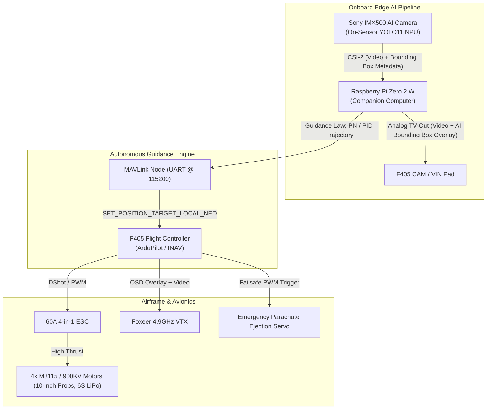

# Autonomous UAV Interceptor Guidance System 🦅🎯

[](https://opensource.org/licenses/MIT)
[](https://www.raspberrypi.com/)
[](https://www.sony-semicon.com/)
[](https://ardupilot.org/)
[](https://mavlink.io/)

An autonomous, vision-guided tactical UAV interceptor designed for high-speed target acquisition and neutralization. The system pairs an ultra-compact **Raspberry Pi Zero 2 W** companion computer with a **Sony IMX500 12MP Intelligent Vision Sensor** (featuring on-sensor NPU running native **YOLO11** inference). The flight control stack executes **Proportional Navigation (PN)** and **PID guidance algorithms**, transmitting real-time velocity and trajectory correction commands to an **F405 flight controller** running **ArduPilot / INAV** via **MAVLink (UART)**.

---

## 🏗️ System Architecture



---

## 🚀 Key Engineering Highlights

### 1. Zero-CPU On-Sensor Edge AI Inference
* Utilizes the **Sony IMX500 Intelligent Vision Sensor**, which integrates an onboard neural network accelerator directly on the camera die.
* Models are compiled into firmware `.rpk` format and executed directly on the sensor, streaming both video and bounding box coordinates over CSI-2 without consuming the host CPU of the Raspberry Pi Zero 2 W.

### 2. Autonomous Guidance Law Implementation
* **Proportional Navigation (PN):** Implements classic proportional navigation guidance laws ($a_n = N \cdot V_c \cdot \dot{\lambda}$) to generate high-speed, lead-pursuit intercept vectors against dynamic airborne targets.
* **Closed-Loop PID Guidance:** Computes angular error from image center to maintain target lock and smooth tracking.
* **Hybrid State Machine:** Seamlessly transitions through operational states: `IDLE` $\rightarrow$ `SEARCH` $\rightarrow$ `ALIGN` $\rightarrow$ `TRACK` $\rightarrow$ `INTERCEPT` $\rightarrow$ `RECOVER`.

### 3. Flight Controller & Telemetry Integration
* Communicates directly with the **F405 Flight Controller** over hardware serial UART using the standard **MAVLink v2** protocol.
* Commands 3D velocity vectors via `SET_POSITION_TARGET_LOCAL_NED` messages.
* Fully compatible with **ArduPilot (ArduCopter / ArduPlane)** and **INAV**.

### 4. Zero-Latency Analog Video Pipeline
* The companion computer composites the neural network's bounding box overlay onto the video stream.
* Composite analog video is outputted via the Pi's **TV-Out pad** into the F405's OSD chip, which overlays flight telemetry (altitude, battery voltage, artificial horizon) before transmitting to ground goggles via a **Foxeer 4.9GHz VTX**.

### 5. Avionics Safety & Failsafe Mechanisms
* **Parachute Recovery System:** Independent 3-stage failsafe triggered automatically upon radio signal loss (`RX_LOSS`):
  1. Instantly disarms all motors to prevent propeller entanglement.
  2. Safety delay for aircraft deceleration.
  3. Actuates a high-torque micro-servo to deploy an emergency recovery parachute.
* **Isolated Power Architecture:** The companion computer and AI sensor are powered through a dedicated **5V Step-Down BEC**, isolated from high-draw motor transients to prevent flight controller brownouts.

---

## 📁 Repository Structure

```text
autonomous-uav-interceptor/
├── config/
│   └── default.yaml             # Guidance parameters, camera resolution, MAVLink baud
├── deploy/
│   └── interceptor.service      # Systemd service for autonomous cold-boot startup
├── docs/
│   ├── api_mavlink.md           # MAVLink message specification
│   └── hardware_wiring.md       # Electrical connections, BEC wiring, and pinouts
├── src/
│   ├── ai_vision/
│   │   ├── camera_csi.py        # IMX500 CSI-2 capture & metadata extraction
│   │   └── overlay.py           # Real-time bounding box overlay renderer
│   ├── flight_control/
│   │   ├── guidance_pn.py       # Proportional Navigation guidance law
│   │   ├── guidance_pid.py      # Angular PID tracking controller
│   │   ├── mavlink_node.py      # Serial MAVLink interface to F405
│   │   └── state_machine.py     # Mission guidance state engine
│   ├── utils/
│   │   └── logger.py            # High-performance telemetry & event logging
│   ├── main.py                  # Primary flight guidance execution thread
│   ├── main_pid.py              # PID-only lightweight guidance mode
│   ├── simple_test_msp.py       # MultiWii Serial Protocol (MSP) diagnostic utility
│   └── test_motor.py            # Benchtop motor spinup & arming validation tool
├── tests/                       # Unit and integration test suites
└── requirements.txt             # Python dependencies
```

---

## ⚙️ Quick Start Guide

### 1. Hardware Connection
* Connect Raspberry Pi Zero 2 W `UART TX/RX` (GPIO 14/15) to F405 `UART RX/TX`.
* Connect Pi Zero 2 W `TV Out` pin to F405 `CAM` pad.
* Connect external 5V 3A BEC output to Pi Zero 2 W power pads.

### 2. Software Installation (Raspberry Pi Zero 2 W)
```bash
# Clone the repository
git clone https://github.com/titleww/autonomous-uav-interceptor.git
cd autonomous-uav-interceptor

# Set up virtual environment
python3 -m venv venv
source venv/bin/activate

# Install required libraries
pip install -r requirements.txt

# Run the guidance system
python src/main.py
```

---

## ⚠️ Bench Safety Notice
* **Always remove all propellers** when testing MAVLink commands, arming sequences, or guidance scripts on the bench. High-output 6S brushless motors can cause severe injury.

---

## 📜 License
This project is licensed under the [MIT License](LICENSE).
